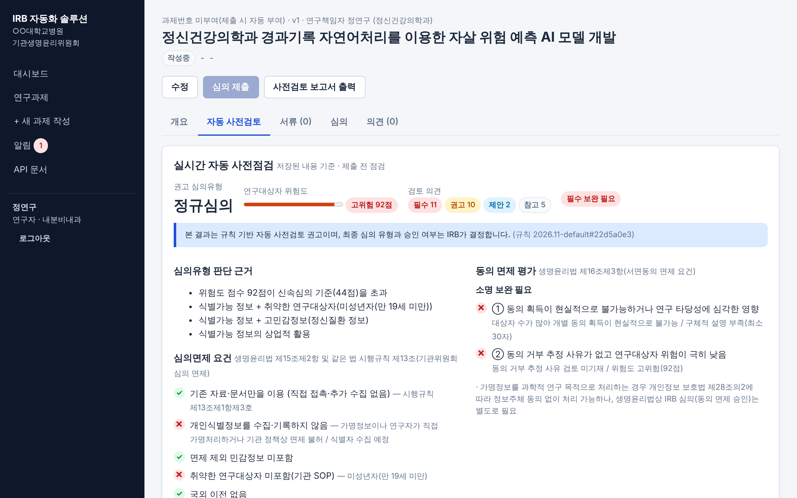
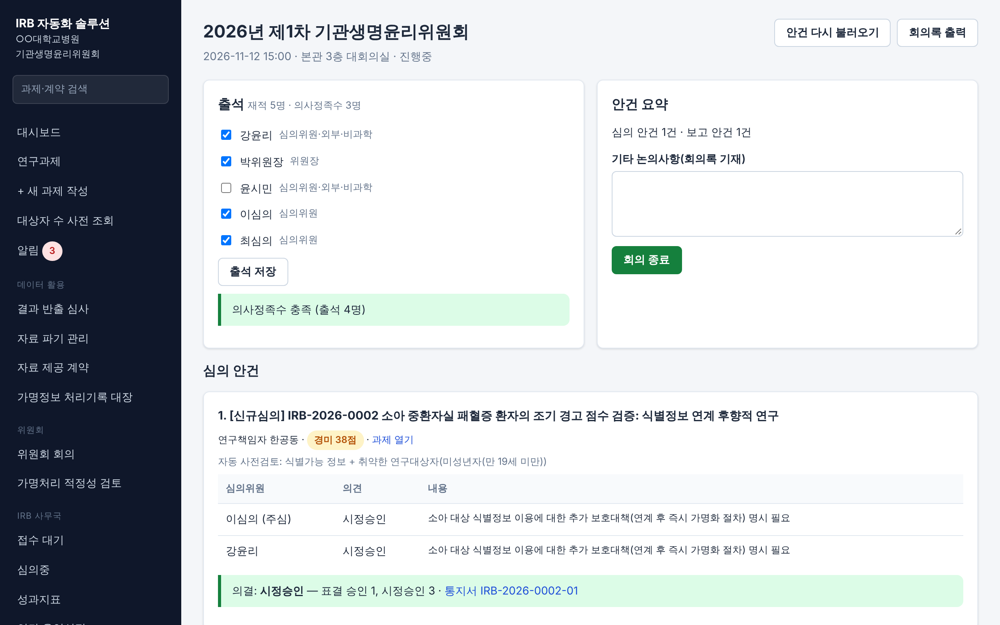
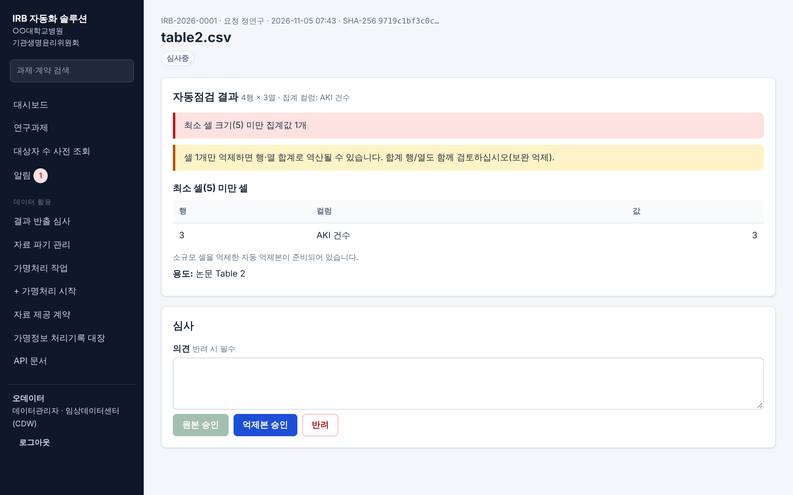
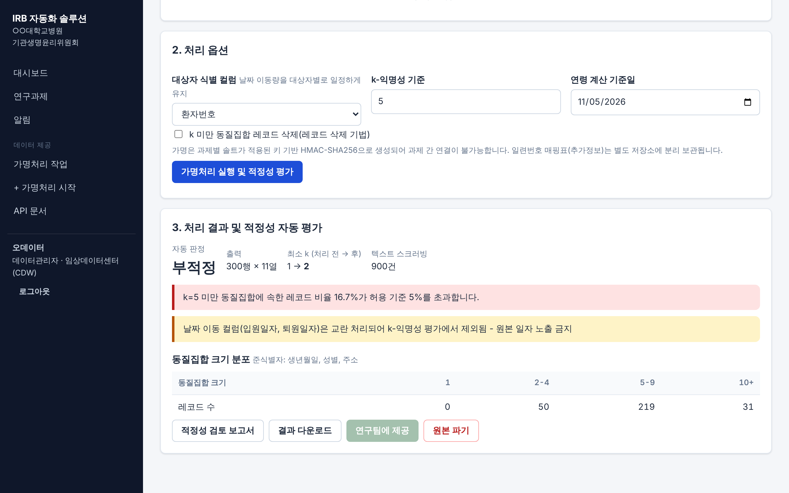

# IRB 자동화 솔루션 v2.0

병원 의료데이터(EMR·CDW·PACS 등)를 연구에 2차 활용할 때 필요한 **IRB 심의와 데이터 거버넌스 전 과정**을 자동화하는 웹 시스템입니다.

**사전 대상자 수 조회 → 계획 작성·서류 자동 작성 → 자동 사전검토 → 전자서명 제출 → 심의·위원회 회의 → 결정·통지 → 가명처리·적정성 검토 → 자료 제공 → 결과 반출 심사 → 지속심의·종료 → 자료 파기**까지 한 흐름으로 처리합니다.

> 자동 분류·검토 결과는 **권고**입니다. 최종 심의 유형과 승인 여부는 IRB가 결정합니다.
> 기본 규칙은 생명윤리법·개인정보 보호법·보건의료데이터 활용 가이드라인을 바탕으로 작성했지만, **각 기관의 SOP에 맞게 검토·수정한 뒤** 사용해야 합니다.
> 기능 선정 근거: [docs/시장조사_기능분석.md](docs/시장조사_기능분석.md)

| 자동 사전검토 | 위원회 회의(정족수·표결) | 결과 반출 심사 |
|---|---|---|
|  |  |  |
| **사무국 대시보드** | **가명처리·적정성 평가** | |
|  |  | |

## 기능 한눈에 보기

| 영역 | 기능 |
|---|---|
| 연구자 | 대상자 수 사전 조회(집계·억제), 계획 작성, **서류 8종 자동 작성**, 실시간 사전점검, **전자서명 제출**, 항목별 보완 답변, 변경·지속·종료 신청, 반출 심사 요청, 파기 확인 |
| 자동 사전검토 | 심의유형 분류(면제/신속/정규), 위험도 점수와 근거, 동의 면제 요건, 필요 서류, 30여 개 규칙 검토 의견(법적 근거 포함), 공동연구자 교육, 다기관·위임심의 |
| IRB 사무국 | 접수 대기열, 항목별 보완 요청, 위원 배정(이해상충 배제), 결정·통지서, **변경 대비표**, 성과지표, **연간 운영실적 보고서**, 감사 로그, 규칙 관리 |
| 위원회 | **회의 생성·안건 자동 구성**, 출석·**의사정족수 판정**, **이해상충 자동 회피**, **표결·과반 판정 → 결정 자동 처리**, **회의록 자동 작성**, 위원 구성 요건 점검 |
| 데이터관리자 | 개인정보 자동 탐지·가명처리·k-익명성, **DRB 적정성 승인 후 제공**, **자료 제공 계약(DUA)**, **결과 반출 심사(airlock)**, **가명정보 처리기록 대장** |
| 보안·감사 | 역할 기반 권한, 전자서명(내용 해시), 해시 체인 감사 로그, CSRF·CSP, 로그인 잠금, 외부 CDN 없음(폐쇄망) |
| 연동 | CDW 승인 확인 API, OMOP CDM feasibility 커넥터, SMTP 메일, CSV 내보내기, (선택) AI 사전검토 보조 |

## 주요 기능 상세

### 1. 자동 사전검토 (접수 전 자동 검증)
- 심의면제(생명윤리법 제15조제2항·시행규칙 제13조) / 신속 / 정규심의 자동 분류와 판단 근거
- 위험도 점수: 식별가능성, 식별자, 민감정보, 취약군, 비정형 데이터, 반출·결합·외부저장, AI·상업적 활용, 규모 등 요인별 기여도 표시
- 동의 면제(제16조제3항) 두 요건 각각 판정, 필요 서류 자동 산출
- 검토 의견: 주민등록번호 수집(제24조의2), 처리자·이용자 미분리, 자유기술 스크러빙, DICOM, 국외이전(제28조의8), 결합(제28조의3), 공동연구자 교육 만료, 다기관 참여기관 누락, 위임심의 등
- **필수 보완 사항이 있으면 제출 차단**. 규칙은 [`rules/default_ruleset.yaml`](irb_automation/rules/default_ruleset.yaml)에서 관리하고 결과마다 규칙 버전(해시)을 기록

### 2. 제출·보완·변경
- **전자서명 제출**: 연구자 서약 동의 + 비밀번호 재인증, 제출 스냅샷의 SHA-256 해시 보관 → 사후 변경 검증
- **항목별 보완 요청**: 사무국이 사전검토 지적사항을 골라 요청, 연구자는 항목마다 답변(미답변 시 재제출 불가)
- **변경 대비표 자동 생성**: 재제출·변경심의 시 직전 제출본과 비교, 위험도에 영향을 주는 핵심 항목 강조
- **서류 자동 작성**: 심의의뢰서, 심의면제 확인 신청서, 동의 면제 사유서, 가명처리 계획서(수집 변수별 처리 방법 자동 제안), 자료수집 항목표, 보안서약서, 변경 대비표, 참여기관 목록

### 3. 위원회 회의
- 회의 생성 시 **정규심의 대기 건은 심의 안건, 직전 회의 이후 신속·면제·종료 결정은 보고 안건으로 자동 구성**
- 출석 체크 → **의사정족수(재적 과반), 사회적·윤리적 위원 출석 여부** 자동 판정(규칙 세트 `committee`로 조정)
- 연구팀 소속 위원 **자동 회피**, 수동 회피 추가 가능
- 표결 입력 → **출석위원 과반 판정** → 승인/시정승인/보완/부결 결정과 통지서 자동 발행
- **회의록 자동 작성**(출석·정족수·안건별 사전검토 요약·위원 의견·회피·논의 요지·표결·의결)
- 위원회 구성 요건 점검(생명윤리법 제11조: 5인 이상·양성·사회적·윤리적 위원·외부위원·임기·교육)

### 4. 데이터 거버넌스
- **가명처리**: 개인정보 자동 탐지 → 기법 권고·적용 → k-익명성·l-다양성·잔존 식별정보 → 적정/조건부/부적정 판정, 결과서
- **DRB 적정성 검토**: 처리자와 분리된 위원이 승인해야 제공(재처리 시 재검토)
- **제공 게이트**: 유효한 IRB 승인 + DRB 승인 + (외부 제공 시) 유효한 자료 제공 계약
- **결과 반출 심사(airlock)**: 결과표의 최소 셀(기본 5) 미만·식별자·자유기술·개인 단위 자료 자동 점검, 자동 억제본, 원본/억제본 승인·반려
- **자료 제공 계약(DUA)**: 유형·조건·기간 관리, 만료 60·30일 전 알림
- **자료 파기 관리**: 종료 시 보관기간으로 파기 기한 자동 설정, 기한 알림, 파기 확인서
- **가명정보 처리기록 대장**(개인정보 보호법 제28조의4) 자동 작성·CSV

### 5. 사전 대상자 수 조회 (Feasibility)
- 진단코드(KCD/ICD 접두어)·성별·연령·기간 조건으로 환자 수를 **집계값으로만** 제공(10명 미만 억제, 10명 단위 반올림)
- 사용자별 일일 한도와 전수 조회 기록으로 차분 공격 완화
- `IRB_CDW_URL`을 지정하면 **OMOP CDM**(person / condition_occurrence) 커넥터 사용, 미지정 시 합성 데이터

### 6. 성과지표·보고
- 심의유형별 처리기간 **중앙값·평균·P90**, **IRB 측 / 연구자 측 시간 분리**, 1회 승인율
- 심의위원 업무량·기한 초과, **자동분류 일치율(권고 → 최종 유형)**, 빈발 보완사항 Top 10
- **연간 운영실적 보고서**(평가·인증 연차보고 기초자료), 과제 목록 CSV

## 빠른 시작

```bash
python3 -m venv .venv && . .venv/bin/activate
pip install -r requirements.txt
python -m irb_automation init-db --demo
python -m irb_automation serve
```

http://127.0.0.1:8000 접속. 데모 계정(공통 비밀번호 `Demo!2026pw`):

| 아이디 | 역할 | 해볼 것 |
|---|---|---|
| `researcher` | 연구자 | 대상자 수 사전 조회, 정규심의 후보 과제의 사전검토·서류 자동 작성, 결과 반출 심사 요청 |
| `researcher2` | 연구자 | 위원회 안건에 오른 소아 PICU 과제 확인 |
| `coordinator` | IRB 간사 | 대기열, 위원회 회의(출석·표결·회의록), 성과지표, 연간 운영실적 |
| `chair` | 위원장 | 정규심의 의결 |
| `reviewer1`~`reviewer4` | 심의위원 | 심의의견 제출, 가명처리 적정성 검토(DRB). `reviewer3·4`는 외부·사회적·윤리적 위원 |
| `steward` | 데이터관리자 | `samples/synthetic_patients.csv` 가명처리 → DRB 승인 후 제공, 반출 심사, 계약·처리기록 대장 |
| `admin` | 시스템관리자 | 사용자·위원 속성·교육이수 관리, 감사 로그 |

데모에는 면제 확인된 과제(+공동연구 협약), 정규심의 대기 과제, 안건이 구성된 다음 주 위원회 회의가 미리 들어 있습니다.

### Docker
```bash
cp .env.example .env   # IRB_SECRET_KEY, IRB_PSEUDONYM_SECRET 반드시 변경
docker compose up -d --build
docker compose exec irb python -m irb_automation create-user admin admin --name 관리자
```

## 운영 명령

```bash
python -m irb_automation init-db                 # DB 생성(기존 DB는 새 컬럼 자동 추가)
python -m irb_automation create-user ID 역할      # researcher|coordinator|reviewer|chair|data_steward|admin
python -m irb_automation run-scheduler           # 만료·계약·파기 알림 (cron 등록 가능, 웹 서버에도 내장)
python -m irb_automation verify-audit            # 감사 로그 위변조 검증
```

## 주요 설정 (환경변수)

| 변수 | 설명 |
|---|---|
| `IRB_SECRET_KEY`, `IRB_PSEUDONYM_SECRET` | 세션 서명 키, 가명처리 HMAC 키(분리 보관) |
| `IRB_DATABASE_URL`, `IRB_DATA_DIR`, `IRB_RULESET_PATH` | DB, 파일 저장소, 기관 규칙 파일 |
| `IRB_APPROVAL_VALIDITY_DAYS`, `IRB_REVIEWER_DUE_DAYS` | 승인 유효기간, 심의 기한 |
| `IRB_SMTP_HOST`, `IRB_SMTP_PORT`, `IRB_SMTP_USER`, `IRB_SMTP_PASSWORD`, `IRB_SMTP_FROM`, `IRB_BASE_URL` | 이메일 알림(선택) |
| `IRB_CDW_URL`, `IRB_CDW_SCHEMA`, `IRB_CDW_DEMO_CSV` | 사전 대상자 수 조회 데이터 원천(OMOP CDM / 데모 CSV) |
| `IRB_INTEGRATION_TOKEN` | CDW 승인 확인 API 토큰 |
| `IRB_AI_REVIEW_ENABLED`, `IRB_AI_MODEL`, `ANTHROPIC_API_KEY` | (선택) AI 사전검토 보조 |

전체 목록: [.env.example](.env.example) · 운영 방법: [docs/운영가이드.md](docs/운영가이드.md)

## 테스트

```bash
pip install -r requirements-dev.txt
pytest -q
```

70개 시나리오: 사전검토 엔진, 가명처리, 업무 흐름(신규→변경→지속→종료, 보완, 부결 복원, 만료), 위원회(정족수·회피·과반·회의록), 전자서명 위변조 검증, 항목별 보완, 변경 대비표, 서류 자동 작성, 반출 심사, DRB 분리, 계약 게이트, 파기, 처리기록 대장, feasibility(데모·OMOP), 지표(IRB/연구자 시간 분리), 컬럼 마이그레이션, 메일 발송, 웹 권한·CSRF.

## 구조

```
irb_automation/
├── engine/        # 자동 사전검토: ruleset, facts, risk, classifier, consent, checklist, findings, ai_review
├── deid/          # 가명처리: patterns, detector, transforms, privacy(k-익명성), pipeline
├── governance/    # airlock(반출 심사), records(계약·파기·DRB·처리기록 대장)
├── workflow/      # service(상태 전이·권한·스케줄러), meetings(위원회), diff(변경 대비표)
├── documents.py   # 서류 자동 작성
├── esign.py       # 전자서명
├── feasibility.py # 사전 대상자 수 조회(OMOP/데모 커넥터)
├── metrics.py     # 성과지표·연간 운영실적
├── rules/         # 기관 SOP 규칙(YAML)
├── web/           # 화면(FastAPI + Jinja2, 정적 파일 내장)
└── api/           # REST API
```

## 운영 전 확인 사항

- [ ] 규칙 세트(심의 분류·위원회 정족수·반출 최소 셀·feasibility 억제 기준)를 기관 SOP와 대조 검토
- [ ] `IRB_SECRET_KEY`, `IRB_PSEUDONYM_SECRET` 설정 및 가명처리 키 분리 보관(HSM/키관리 서버)
- [ ] HTTPS 리버스 프록시 + `IRB_SESSION_HTTPS_ONLY=true`, 원내망 접근 제한
- [ ] 운영 DB(PostgreSQL) 전환·백업, `data/` 디렉터리 권한
- [ ] 위원 명부(위원·외부·사회적·윤리적 위원·성별·임기) 입력 후 구성 요건 점검
- [ ] 병원 SSO 연동 필요 시 `web/deps.py` 인증 계층 교체
- [ ] AI 보조·메일 발송 사용 시 기관 승인 및 외부 전송 정책 확인
