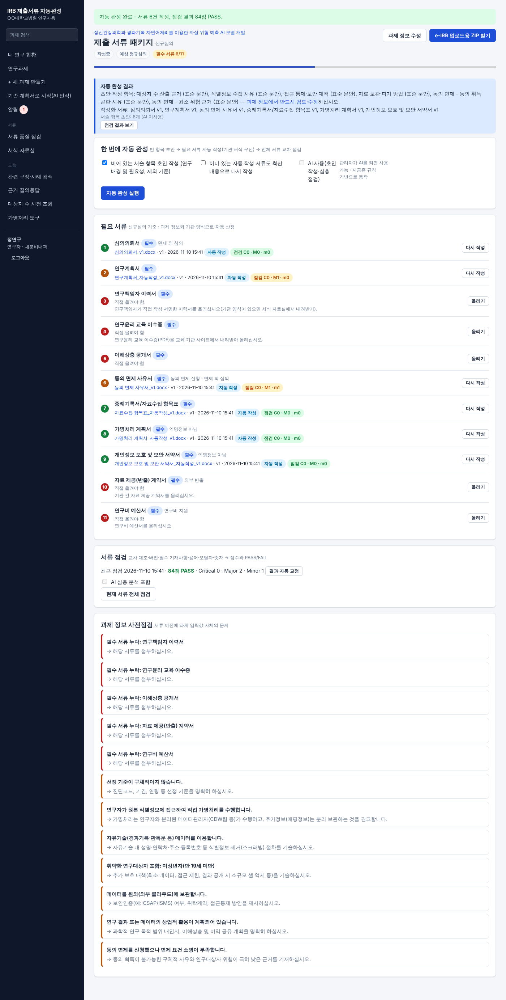
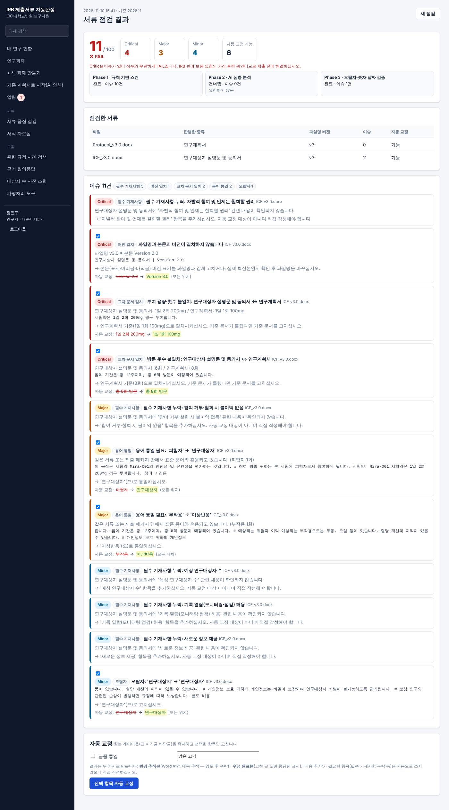
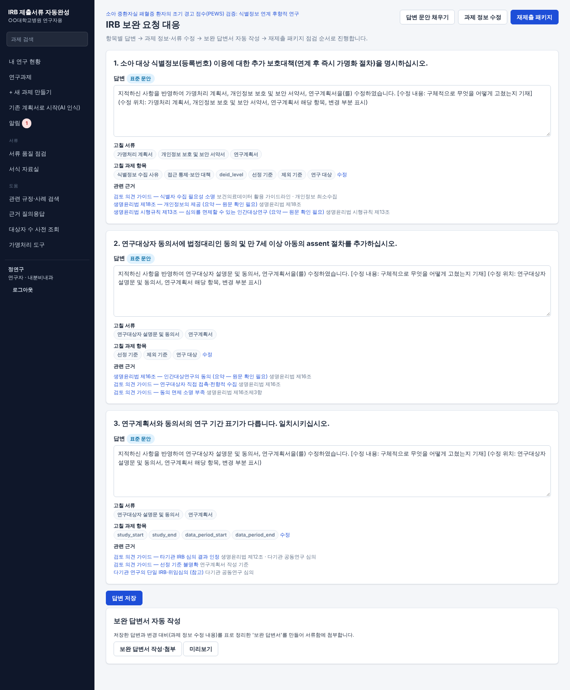
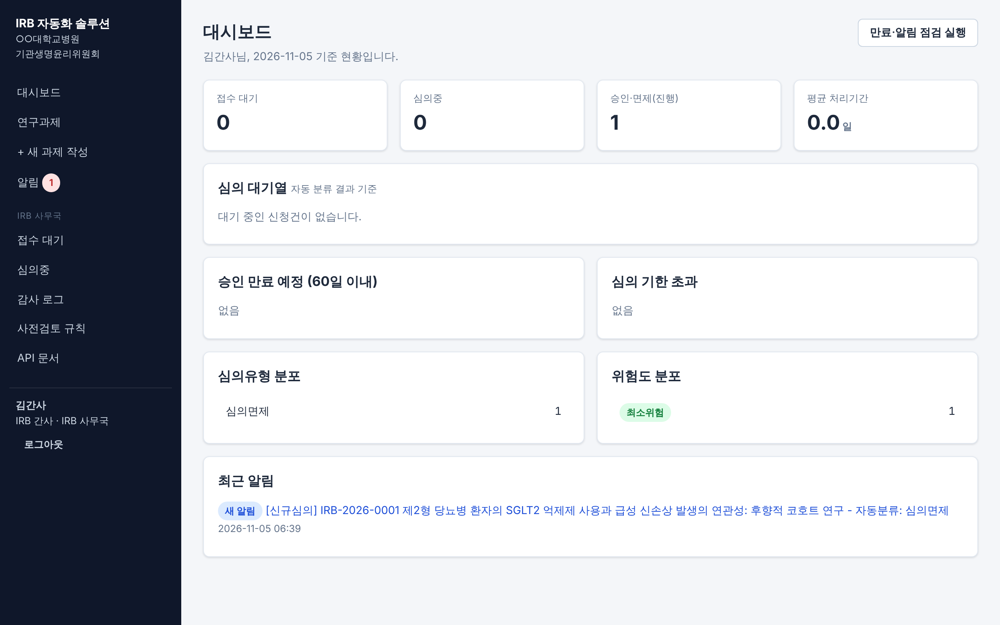
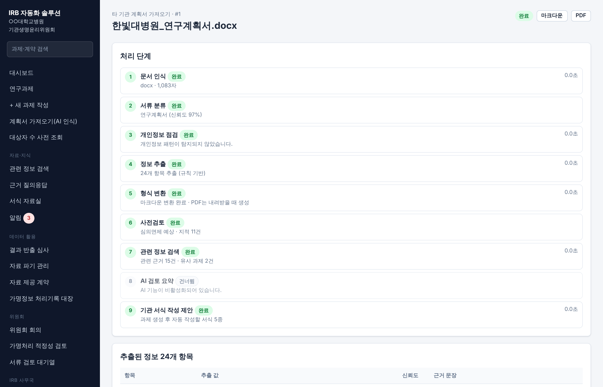
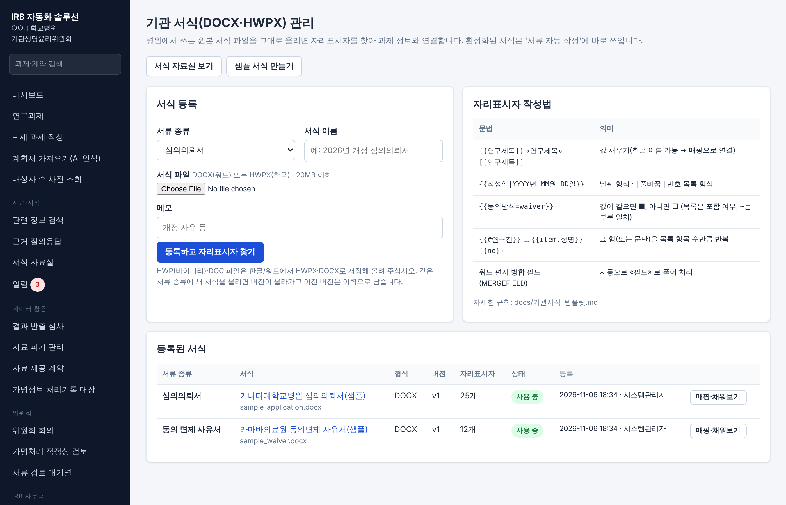

# IRB 제출서류 자동완성 v4.0 (연구자용)

병원 의료데이터(EMR·CDW·PACS 등)를 활용하는 연구자가 **IRB(기관생명윤리위원회)에 낼 서류를 자동으로 완성하고, 제출 전에 서류끼리 교차 점검해 고쳐 주는** 웹 도구입니다.
심의는 병원 e-IRB에서 이뤄지고, 이 도구는 **연구자 쪽 준비 작업**(작성·점검·보완 대응)을 맡습니다.

```
과제 정보 1회 입력(또는 기존 계획서 업로드 → AI 인식)
  → 필요 서류 자동 산정 → 서류 자동 작성(기관 DOCX·HWPX 서식 우선) + 빈 항목 초안
  → 서류 품질 점검(교차 대조·버전·필수 기재사항·용어·오탈자 → 점수·PASS/FAIL)
  → 자동 교정(변경 추적본·수정 완료본, 서식 보존) → e-IRB 업로드용 ZIP
  → 제출 기록 → IRB 보완 요청 붙여넣기 → 답변 초안·보완 답변서 → 재제출 → 결과 기록·만료 알림
```

> 자동 작성·점검 결과는 **연구자의 검토를 돕는 도구**입니다. 최종 내용은 연구자가 확인하고, 심의 결과는 IRB가 결정합니다.
> 점검 기준(`irb_automation/qc/criteria.yaml`)과 사전점검 규칙(`irb_automation/rules/default_ruleset.yaml`)은 생명윤리법·개인정보 보호법·ICH-GCP를 바탕으로 작성한 기본값이므로 **기관 SOP에 맞게 수정**해 사용하십시오.

| 제출 서류 패키지(자동 완성) | 서류 품질 점검(교차 대조·점수) | 보완 요청 대응 |
|---|---|---|
|  |  |  |
| **내 연구 현황** | **AI 문서 인식(기존 계획서 가져오기)** | **기관 서식(DOCX·HWPX)** |
|  |  |  |

## 핵심 기능

### 1. 제출 서류 패키지 자동 완성
- 제출 구분(신규·보완 재제출·변경·지속·종료)과 과제 조건(동의 면제·식별정보·외부 제공·연구비 등)에 따라 **필요 서류를 자동 산정**합니다.
- **한 번에 자동 완성**:
  1. 비어 있는 서술 항목(대상자 수 근거·보안 대책·보관·파기·동의 면제 사유 등) 초안 작성
  2. 연구계획서·동의서·심의의뢰서·동의 면제 사유서·가명처리 계획서·자료수집 항목표·보안 서약서 등 **자동 작성** — 병원 고유 DOCX/HWPX 서식이 등록돼 있으면 그 서식에 채움, 없으면 기본 서식을 **편집 가능한 DOCX**로 생성
  3. 전체 서류 품질 점검
- 개인 서류(이력서·교육 이수증)는 업로드 안내, 웹 서식(이해상충 등)은 연구진별 작성 현황 표시
- **e-IRB 업로드용 ZIP**: `01_연구계획서_v2.docx` 식의 번호·서류명·버전 파일명 + 제출 서류 목록·점검 요약

### 2. 서류 품질 점검 (참고: 임상 문서 QC 도구의 접근)
| 점검 | 내용 | 예 |
|---|---|---|
| 교차 문서 일치 | 계획서·동의서·신청서 사이의 대상자 수·투여 용량·방문 횟수·참여 기간·연구 기간·시험약·보관 기간 | 계획서 "1일 1회 100mg" ↔ 동의서 "1일 2회 200mg" → **Critical** |
| 과제 정보 일치 | 서류 값과 시스템에 입력한 과제 정보 비교(이 도구만의 기준값) | 동의서 1,500명 ↔ 과제 1,800명 |
| 버전 일치 | 파일명 버전 ↔ 본문·머리글·바닥글 버전(v3.0 / Ver 3.0 / 버전 3.0 / Version 3.0) | `ICF_v3.0.docx` 본문 "Version 2.0" → **Critical** |
| 필수 기재사항 | 서류 종류별 DB(동의서 20항목·계획서 14항목·면제 사유서·가명처리 계획서 등), 소아 연구는 법정대리인·assent 추가 | "자발적 참여·철회 권리" 누락 |
| 용어 통일 | 피험자→연구대상자, 부작용→이상반응, 비식별화→가명처리 등 | 혼용 시 Major |
| 미기입·개인정보 | 자리표시자(○○○, {{ }}, (작성)), 서류 속 실제 주민번호 등 | |
| 규제 준수 | 보관 기간 3년 미만, 동의 계획과 서류 불일치 | |
| 오탈자·숫자·날짜 | 오탈자 사전, 단어 반복, 존재하지 않는 날짜, 종료일<시작일, 문서 내 표기 불일치 | |
| AI 심층 분석(선택) | 문맥 모순·규제 비준수·가독성(Claude, 개인정보 마스킹 후 전송) | |

- **3단계 스캔**: ① 규칙 기반 → ② AI 심층 → ③ 오탈자·숫자·날짜
- **정량 판정**: 100점에서 Critical −15 · Major −7 · Minor −2. **Critical 1건이라도 있으면 FAIL**, 80점 미만도 FAIL
- **자동 교정**: 선택한 이슈를 원본 레이아웃(표·머리글·바닥글)을 유지한 채 고침
  - **변경 추적본**: Word 변경 내용 추적(수락/거부 가능)
  - **수정 완료본**: 고친 곳 노란 형광펜, 선택 시 글꼴 통일
  - 과제 서류는 새 버전으로 저장 → 재점검
- 과제 없이 **빠른 점검**도 가능(파일만 올려 점검·교정)

### 3. IRB 보완 요청 대응
- IRB 보완 요청문을 붙여넣으면 번호·글머리 기준으로 **항목별 분리**
- 항목마다 **답변 초안**(규칙 문안 또는 AI), **고칠 서류·과제 항목**, **관련 법령·가이드** 표시
- **보완 답변서(보완 대비표)** 자동 작성 → 재제출 패키지 점검

### 4. 병원마다 다른 양식
- 기관 프로필, 신청서 **기관 추가 항목**, **웹 작성 서식**(연구진 개인별), 양식 팩(YAML)
- 병원 고유 **DOCX·HWPX 서식 업로드 → 자리표시자 자동 인식·매핑 → 자동 채움**

### 5. AI 문서 인식 · 관련 정보 검색 · 보조 도구
- 다른 병원 양식의 기존 계획서(PDF·DOCX·HWPX·HWP)를 올리면 **항목 추출 → 새 과제 초안**
- 서류 업로드 시 인식·분류·개인정보 점검 파이프라인
- 법령·지침·FAQ·기관 SOP·**과거 IRB 결과와 보완 요청 사례** 검색, 근거 인용 질의응답
- IRB 사전점검(예상 심의유형·위험도·동의 면제 요건), 대상자 수 사전 조회, 가명처리 도구(k-익명성 평가 보고서)

## 처음 사용할 때

- **화면별 가이드(?)**: 모든 화면 오른쪽 아래 **?** 버튼에 그 화면의 기능과 '처음 하면 좋은 일'이 있습니다. 처음 들어간 화면에서는 자동으로 열립니다(자동 열기는 가이드 안에서 끌 수 있음). 전체 목록은 `/help`에 있습니다.
- **샘플 데이터** (`/samples`): 다른 병원 양식 계획서(DOCX·HWPX·HWP·PDF), 오류를 넣은 점검용 계획서·동의서, 개인 서류 PDF, IRB 보완 요청문, 가상 환자 CSV, 기관 서식 예시를 내려받아 각 화면에서 시험할 수 있습니다.
- **전체 파이프라인 테스트** (`/demo`, 또는 `python -m irb_automation demo-pipeline`): 샘플 계획서 하나로 15단계를 자동 실행하고 단계별 결과와 링크를 보여 줍니다.
  - AI 인식 → 과제 생성 → 사전점검 → 서류 자동 완성 → 개인 서류 첨부
  - 오류 주입 → 교차 점검 → 자동 교정 → 재점검
  - ZIP → 제출 기록 → 보완 요청 → 답변 → 보완 답변서 → 재제출 → 승인

## 빠른 시작

```bash
python3 -m venv .venv && . .venv/bin/activate
pip install -r requirements.txt
python -m irb_automation init-db --demo
python -m irb_automation serve
```

http://127.0.0.1:8000 접속. 데모 계정(공통 비밀번호 `Demo!2026pw`):

| 아이디 | 역할 | 해볼 것 |
|---|---|---|
| `researcher` | 연구자 | 작성중 과제 → **제출 서류 패키지 → 자동 완성 실행** → 점검 결과·자동 교정, **서류 품질 점검 → 샘플 서류로 체험** |
| `researcher2` | 연구자 | 보완 요청을 받은 소아 PICU 과제 → **보완 대응** |
| `admin` | 관리자(연구지원) | 기관 프로필·양식·서식·점검 기준·지식 관리, 사용자 관리 |

DOCX 자동 작성에는 LibreOffice(`soffice`)가 필요합니다(없으면 HTML로 첨부). Docker 이미지·Codespaces 사용 시 설치 여부를 확인하십시오.

### GitHub Codespaces로 시연
1. 저장소 → **Code ▸ Codespaces ▸ Create codespace on `claude/gifted-hawking-yh1og1`**
2. 생성이 끝나면 터미널에 `접속 주소`와 `데모 비밀번호`가 출력됩니다(`bash scripts/codespaces_start.sh`로 다시 볼 수 있음).
3. 주소가 열리지 않으면 **포트** 탭 → 8000 → 가시성을 *Public*으로 변경하십시오. 공개 주소는 아는 사람 누구나 접속할 수 있으므로 **실제 환자 정보는 넣지 마십시오.**

### Docker
```bash
cp .env.example .env   # IRB_SECRET_KEY, IRB_PSEUDONYM_SECRET 반드시 변경
docker compose up -d --build
docker compose exec irb python -m irb_automation create-user admin admin --name 관리자
```

## 운영 명령

```bash
python -m irb_automation init-db                 # DB 생성(기존 DB는 새 컬럼 자동 추가)
python -m irb_automation create-user ID 역할      # researcher | admin
python -m irb_automation run-scheduler           # 승인 만료 전 알림(지속심의 준비), 웹 서버에도 내장
python -m irb_automation verify-audit            # 감사 로그 위변조 검증
```

## 주요 설정 (환경변수)

| 변수 | 설명 |
|---|---|
| `IRB_SECRET_KEY`, `IRB_PSEUDONYM_SECRET` | 세션 서명 키, 가명처리 HMAC 키(분리 보관) |
| `IRB_DATABASE_URL`, `IRB_DATA_DIR`, `IRB_RULESET_PATH` | DB, 파일 저장소, 사전점검 규칙 파일 |
| `IRB_QC_CRITERIA_PATH` | 서류 점검 기준 파일(기관용 사본) |
| `IRB_APPROVAL_VALIDITY_DAYS` | 결과 입력 시 만료일을 비웠을 때 기본 승인 기간 |
| `IRB_SOFFICE_PATH` | LibreOffice 경로(DOCX 자동 작성·HWP 변환) |
| `IRB_AI_ENABLED`, `IRB_AI_MODEL`, `ANTHROPIC_API_KEY` | (선택) AI 초안·심층 점검·문서 인식·질의응답 |
| `IRB_SMTP_*`, `IRB_BASE_URL` | 이메일 알림(선택) |
| `IRB_CDW_URL`, `IRB_CDW_SCHEMA`, `IRB_CDW_DEMO_CSV` | 대상자 수 사전 조회 데이터 원천 |

전체 목록: [.env.example](.env.example) · 화면별 안내: [docs/기능_및_화면_안내.md](docs/기능_및_화면_안내.md) · 점검 기준: [docs/서류점검.md](docs/서류점검.md)

## 테스트

```bash
pip install -r requirements-dev.txt
pytest -q
```

150여 개 시나리오: 서류 점검(사실 추출·버전·교차/과제 정보 대조·점수·AI 단계 가짜 클라이언트), DOCX 자동 교정(변경 추적·형광펜·머리글·글꼴, 재점검 시 이슈 해소), 패키지 자동 완성·ZIP, 보완 요청 분리·답변 초안, 제출·결과·변경·지속·종료·만료, 기관 양식·서식 엔진, 업로드 검증·버전, AI 문서 인식 파이프라인, 지식 검색·권한, 가명처리, 웹 권한·CSRF.

## 구조

```
irb_automation/
├── qc/            # 서류 품질 점검: criteria.yaml(점검 기준 DB), facts(값 추출), checks(규칙), ai_phase, autofix, service
├── package/       # 제출 서류 패키지: service(필요 서류·자동 완성·ZIP), drafting(서술 초안), revision(보완 대응)
├── engine/        # IRB 사전점검: 심의유형·위험도·동의 면제·필요 서류·검토 의견
├── documents.py   # 서류 자동 작성(기본 서식 → DOCX)
├── doctemplates/  # 병원 DOCX·HWPX 서식 채우기
├── forms/         # 기관 프로필·추가 항목·웹 서식·양식 팩
├── submission/    # 서류함: 업로드 검증·버전·미리보기·비교·합본
├── docproc/ ai/ pipeline/  # 문서 인식·Claude 클라이언트·개인정보 가드·문서 분석 파이프라인
├── knowledge/     # 법령·지침·과거 IRB 결과 검색, 근거 질의응답
├── deid/          # 가명처리 도구
├── workflow/      # 과제 진행(제출 기록·보완·결과·변경·만료 알림)
├── web/ api/      # 화면(FastAPI + Jinja2, 외부 CDN 없음), REST API
```

## 운영 전 확인 사항

- [ ] 점검 기준(`qc/criteria.yaml`)과 사전점검 규칙을 기관 SOP·IRB 서식 요건과 대조해 수정
- [ ] 병원 고유 서식(DOCX·HWPX) 등록과 자리표시자 매핑 확인
- [ ] `IRB_SECRET_KEY`, `IRB_PSEUDONYM_SECRET` 설정, HTTPS + `IRB_SESSION_HTTPS_ONLY=true`, 원내망 접근 제한
- [ ] LibreOffice 설치(DOCX 자동 작성), 운영 DB(PostgreSQL) 전환·백업
- [ ] AI 사용 시 기관 승인, 전송 허용 서류 범위(`IRB_AI_DOC_TYPES_ALLOWED`) 확인
- [ ] 병원 SSO 연동 필요 시 `web/deps.py` 인증 계층 교체
